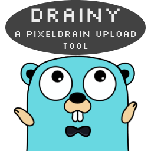
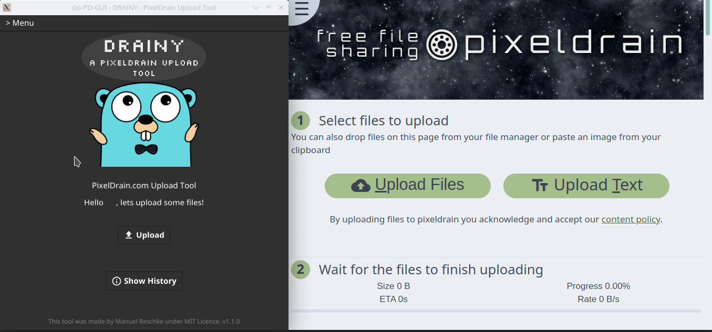
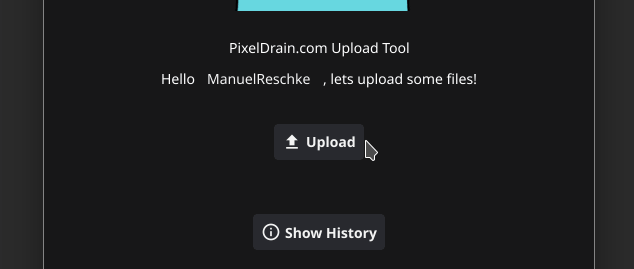

# Go-PD-GUI -DRAINY
A free easy to use cross plattform upload tool for pixeldrain.com.
* Windows x32/x64
* Linux x64
* Android APK ARM / ARM64



**Current version:** v1.3.0 · [Changelog](CHANGELOG.md)

## Preview


Progress bar


## Download binaries

Pre-built packages are published on the [GitHub Releases](https://github.com/ManuelReschke/go-pd-gui/releases) page (latest: [v1.3.0](https://github.com/ManuelReschke/go-pd-gui/releases/tag/v1.3.0)).

* Windows:
  * [Windows 64 Bit](https://github.com/ManuelReschke/go-pd-gui/releases/latest/download/DRAINY_Windows_x64.zip)
  * [Windows 32 Bit](https://github.com/ManuelReschke/go-pd-gui/releases/latest/download/DRAINY_Windows_x86.zip)
* Linux:
  * [Linux 64 Bit](https://github.com/ManuelReschke/go-pd-gui/releases/latest/download/DRAINY_Linux_x64.tar.xz)
* Android:
  * [Android ARM64](https://github.com/ManuelReschke/go-pd-gui/releases/latest/download/DRAINY_Android_arm64.apk)
  * [Android ARM](https://github.com/ManuelReschke/go-pd-gui/releases/latest/download/DRAINY_Android_arm.apk)

### Cutting a release

```bash
# 1. Bump version in FyneApp.toml (and CHANGELOG.md)
# 2. Commit, then tag and push:
git tag v1.4.0
git push origin v1.4.0
```

GitHub Actions builds all platforms with **fyne-cross** and publishes the assets via **GoReleaser**.

### Features:

* upload to pixeldrain (with infinite progress bar)
* support auth via API-Key (*optional)
  * save and load API-Key from user settings
* output file url
* "Copy" button to copy link easily
* real progress bar (1 .. 100)

### ToDos:

* [x] ~~implement real progress bar (1 .. 100)~~

## Changelog

See [CHANGELOG.md](CHANGELOG.md) for release history and upgrade notes.

## License

This software is released under the MIT License, see LICENSE.